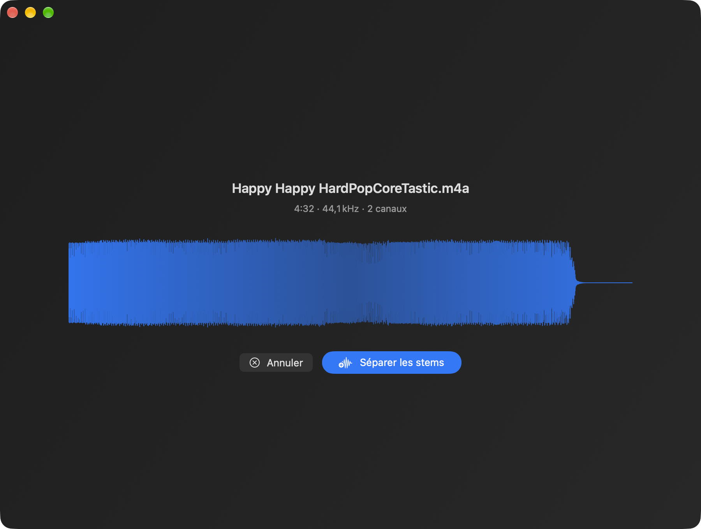
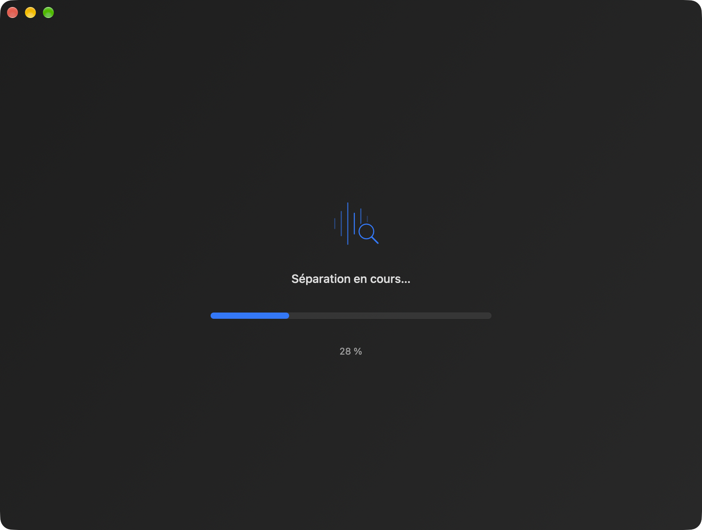
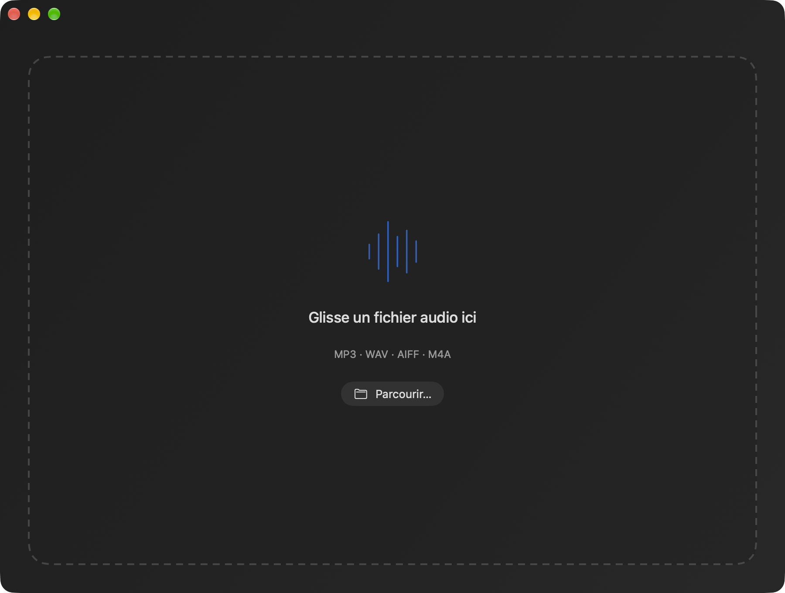

# Quatuor

[](https://github.com/gwenn-ha-dev/Quatuor/actions/workflows/ci.yml)
[](./LICENSE)


*🇬🇧 [English](./README.md) · 🇫🇷 Français*

App macOS native de séparation de stems — isole voix, batterie, basse et autres instruments de n'importe quel morceau, par apprentissage profond, entièrement sur le GPU Apple Silicon. Quatre stems : un quatuor.


## Fonctionnalités

- **Glisser-déposer** n'importe quel fichier audio (MP3, WAV, AIFF, M4A), ou le choisir avec *Parcourir…*.
- **Séparation accélérée GPU** via MLX sur Apple Silicon (Metal).
- **htdemucs_ft** — le Hybrid Transformer Demucs affiné de Meta.
- **Lecture multipiste synchronisée** — tous les stems au pas via `AVAudioEngine`, démarrés sur la même heure hôte.
- **Mute / solo / volume** par stem — karaoké instantané : coupe la voix et chante dessus.
- **Vue waveform** avec progression live et clic pour naviguer, **export MP3** (un stem ou tout, VBR V2 via libmp3lame).
- **Mémoire adaptative** : le cache Metal de MLX est plafonné à 70 % de la mémoire disponible ; modèle et tampons sont libérés après séparation.
- Anglais et français, selon la langue du système.

| Prêt à séparer | Séparation |
|---|---|
|  |  |

## Installation

Télécharge **`Quatuor-<version>.dmg`** depuis la [dernière release](https://github.com/gwenn-ha-dev/Quatuor/releases/latest), ouvre-le et glisse Quatuor dans Applications. L'app est signée avec un Developer ID et notarisée par Apple : elle s'ouvre d'un double clic. Il faut un Mac Apple Silicon et macOS 26.4 ou plus récent.

La première séparation télécharge le modèle, environ 670 Mo, depuis Hugging Face dans le cache de l'app ; les suivantes se font hors ligne.

Pour construire depuis les sources (le toolchain Metal est requis : `xcodebuild -downloadComponent MetalToolchain`) :

```sh
git clone https://github.com/gwenn-ha-dev/Quatuor.git
cd Quatuor
make package      # build/Quatuor.app
```

## Utilisation



1. Dépose un morceau sur la fenêtre. Quatuor affiche sa waveform, sa durée et sa fréquence d'échantillonnage.
2. Clique sur **Séparer les stems**. Le morceau de 4:32 de ces captures a pris environ une minute sur un M1 Pro.
3. Écoute le résultat, coupe ou isole des stems, puis exportes-en un avec **MP3** ou les quatre avec **Tout exporter**.

**Nouveau** ramène à la zone de dépôt ; les stems séparés sont des fichiers temporaires, supprimés quand on quitte le résultat ou l'app.

## Comment ça marche

Le morceau est décodé par AVFoundation et confié à [demucs-mlx-swift](https://github.com/kylehowells/demucs-mlx-swift), un portage de Demucs sur MLX, qui exécute `htdemucs_ft` — un modèle affiné par stem — sur le GPU. Chaque stem est écrit en WAV 16 bits dans le dossier temporaire de l'app ; la lecture programme les quatre fichiers sur quatre `AVAudioPlayerNode` démarrés sur la même heure hôte, si bien que muet, solo et volume agissent sur des stems qui ne se décalent jamais. L'export MP3 encode ces WAV avec LAME.

`Stem`, `StemKind` et `StemPlayer` gardent leurs noms dans tout le code : *stem* est le terme audio pour une piste séparée, et il reste le mot juste quel que soit le nom de l'app.

## Construction

| Commande | Ce qu'elle fait |
|---|---|
| `make build` | Compilation release, tout avertissement est une erreur |
| `make test` | Lance la suite de tests |
| `make run` | Lance l'app |
| `make icon` | Régénère `Resources/AppIcon.icns` |
| `make package` | Archive l'app dans `build/Quatuor.app` |
| `make sign` | La signe avec un Developer ID, la notarise et agrafe le ticket |
| `make dmg` | Produit le `build/Quatuor-<version>.dmg` notarisé |
| `make shots` | Refait les captures du README (`outils/captures.sh`) |
| `make release-check` | Dit si `build/` est publiable |
| `make lint` | Vérifie la conformité à la charte |
| `make help` | Liste toutes les cibles |

## Dépendances

- [demucs-mlx-swift](https://github.com/kylehowells/demucs-mlx-swift), au-dessus de [MLX-Swift](https://github.com/ml-explore/mlx-swift), pour l'inférence GPU. Les poids de `htdemucs_ft` sont téléchargés à la première utilisation depuis le dépôt Hugging Face `iky1e/demucs-mlx`.
- [LAME](https://lame.sourceforge.io) 3.100 pour l'encodage MP3 (LGPL), construit depuis les sources par `make deps` et lié statiquement.

Tout le reste est en frameworks Apple.

Les captures du README utilisent « Happy Happy HardPopCoreTastic » de Mesostic, versé dans le domaine public ([CC0, Wikimedia Commons](https://commons.wikimedia.org/wiki/File:Happy_Happy_HardPopCoreTastic.ogg)).

## Licence

MIT © 2026 gwenn-ha-dev — voir [LICENSE](./LICENSE).
