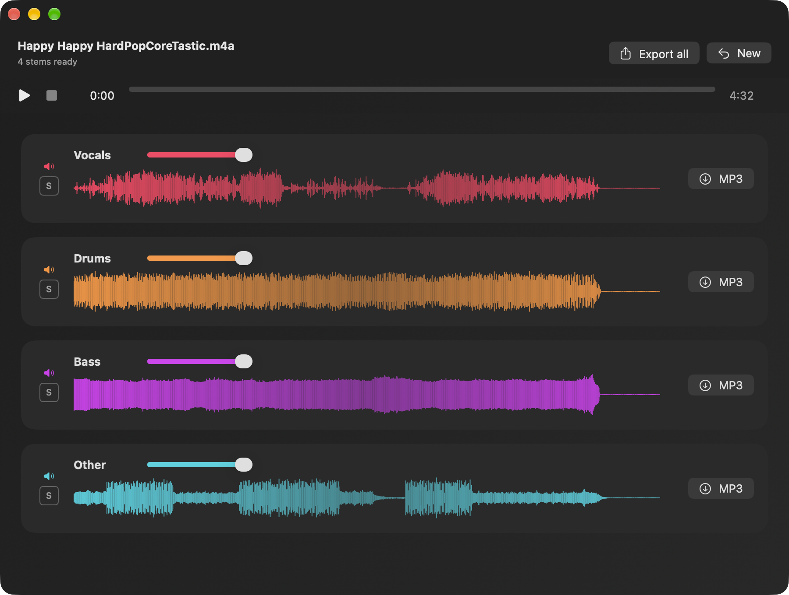
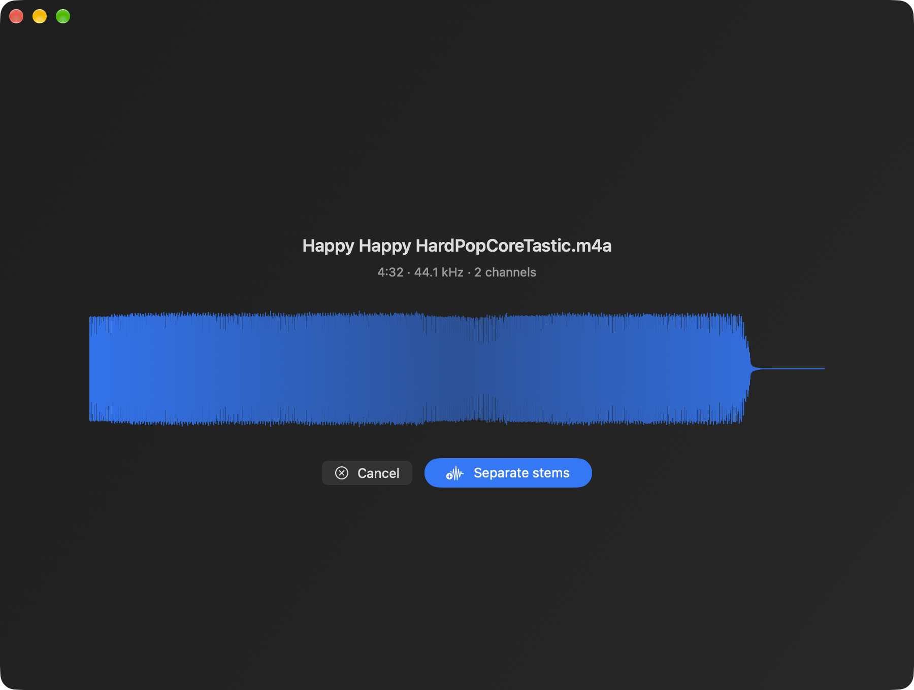
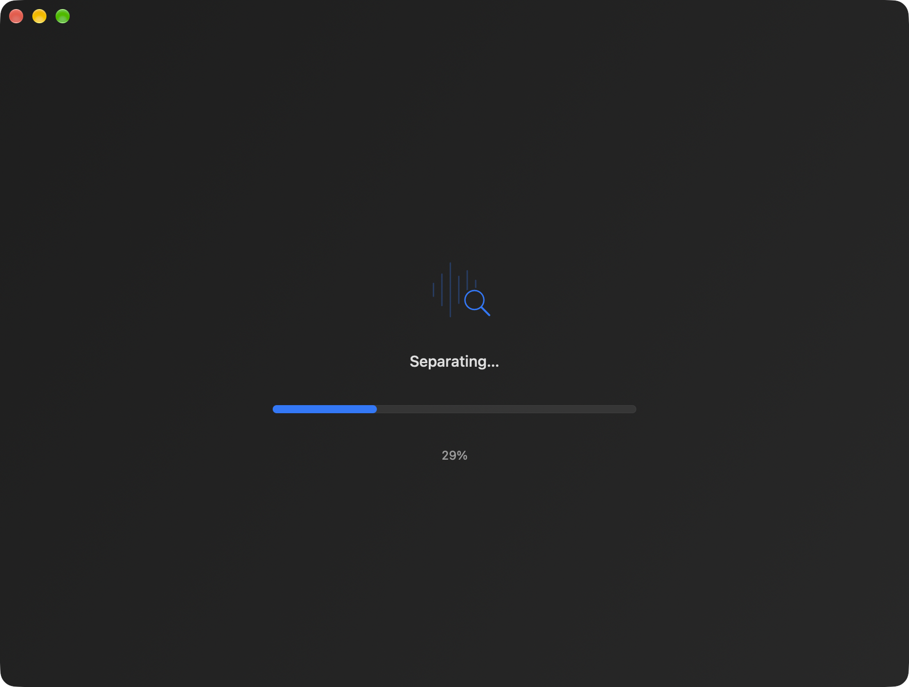
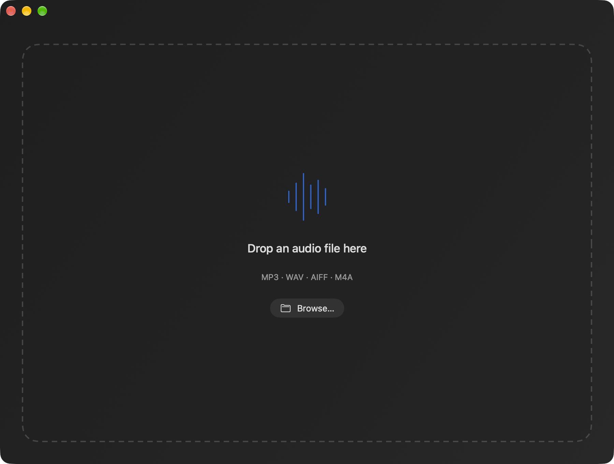

# Quatuor

[](https://github.com/gwenn-ha-dev/Quatuor/actions/workflows/ci.yml)
[](./LICENSE)


*🇬🇧 English · 🇫🇷 [Français](./README.fr.md)*

A native macOS app for audio stem separation — isolate vocals, drums, bass and other instruments from any song using state-of-the-art deep learning, running entirely on the Apple Silicon GPU. Four stems: a quartet.



## Features

- **Drag and drop** any audio file (MP3, WAV, AIFF, M4A), or pick one with *Browse…*.
- **GPU-accelerated** separation via MLX on Apple Silicon (Metal).
- **htdemucs_ft** — Meta's fine-tuned Hybrid Transformer Demucs.
- **Synchronised multi-track playback** — all stems in lock-step via `AVAudioEngine`, started on the same host time.
- **Mute / solo / volume** per stem — instant karaoke: mute the vocals and sing along.
- **Waveform view** with live progress and click-to-seek, **MP3 export** (single stem or batch, VBR V2 via libmp3lame).
- **Adaptive memory**: the MLX Metal cache is capped at 70 % of available system memory; model and buffers are released after separation.
- English and French, following the system language.

| Ready to separate | Separating |
|---|---|
|  |  |

## Install

Download **`Quatuor-<version>.dmg`** from the [latest release](https://github.com/gwenn-ha-dev/Quatuor/releases/latest), open it and drag Quatuor onto Applications. The app is signed with a Developer ID and notarized by Apple: it opens with a double click. It needs a Mac with Apple Silicon and macOS 26.4 or later.

The first separation downloads the model, about 670 MB, from Hugging Face into the app's cache; every later one runs offline.

To build from source instead (the Metal toolchain is required: `xcodebuild -downloadComponent MetalToolchain`):

```sh
git clone https://github.com/gwenn-ha-dev/Quatuor.git
cd Quatuor
make package      # build/Quatuor.app
```

## Usage



1. Drop a song on the window. Quatuor shows its waveform, duration and sample rate.
2. Click **Separate stems**. The 4:32 song of these captures took about a minute on an M1 Pro.
3. Play the result, mute or solo stems, then export one stem with **MP3** or all four with **Export all**.

**New** goes back to the drop zone; the separated stems are temporary files, deleted when you leave the result or quit.

## How it works

The song is decoded by AVFoundation and handed to [demucs-mlx-swift](https://github.com/kylehowells/demucs-mlx-swift), a port of Demucs to MLX, which runs `htdemucs_ft` — one fine-tuned model per stem — on the GPU. Each stem is written as a 16-bit WAV in the app's temporary directory; playback schedules the four files on four `AVAudioPlayerNode`s started on the same host time, so mute, solo and volume act on stems that never drift apart. MP3 export encodes those WAVs with LAME.

`Stem`, `StemKind` and `StemPlayer` keep their names throughout the code: *stem* is the audio term for a separated track, and it stays the right word whatever the app is called.

## Build

| Command | What it does |
|---|---|
| `make build` | Release build, warnings are errors |
| `make test` | Run the test suite |
| `make run` | Launch the app |
| `make icon` | Regenerate `Resources/AppIcon.icns` |
| `make package` | Archive the app into `build/Quatuor.app` |
| `make sign` | Sign it with a Developer ID, notarize and staple it |
| `make dmg` | Build the notarized `build/Quatuor-<version>.dmg` |
| `make shots` | Retake the README captures (`outils/captures.sh`) |
| `make release-check` | Say whether `build/` is publishable |
| `make lint` | Check compliance with the project charter |
| `make help` | List every target |

## Dependencies

- [demucs-mlx-swift](https://github.com/kylehowells/demucs-mlx-swift), on top of [MLX-Swift](https://github.com/ml-explore/mlx-swift), for GPU inference. The `htdemucs_ft` weights are downloaded at first use from the Hugging Face repository `iky1e/demucs-mlx`.
- [LAME](https://lame.sourceforge.io) 3.100 for MP3 encoding (LGPL), built from source by `make deps` and linked statically.

Everything else is Apple frameworks.

The README captures use "Happy Happy HardPopCoreTastic" by Mesostic, dedicated to the public domain ([CC0, Wikimedia Commons](https://commons.wikimedia.org/wiki/File:Happy_Happy_HardPopCoreTastic.ogg)).

## License

MIT © 2026 gwenn-ha-dev — see [LICENSE](./LICENSE).
